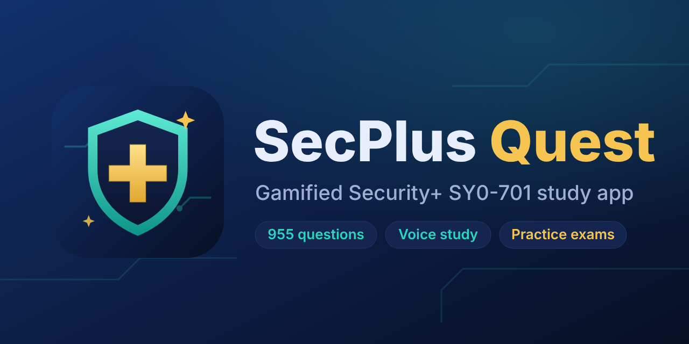

<p align="center"></p>

# SecPlus Quest

**A gamified, voice-enabled study app for the CompTIA Security+ SY0-701 exam.**

**996 original practice questions** and **24 performance-based questions (PBQs)** cover all 28 SY0-701 objectives. They're organized into **120 course sections** that follow the order of Professor Messer's SY0-701 course notes, so you can study alongside his videos. There's also a Network Foundations warm-up bank. Every question comes with an explanation of *why* the right answer is right. You can read, listen, and play your way to passing Security+.

▶️ **Play it:** https://techlady93.github.io/secplus-quest/

---

## Features

| Mode | What it does |
|---|---|
| 🧭 **Course Path** | Works through all 120 sections in course order (1.1 Security Controls → … → 5.6 User Training), one topic at a time. A 🏁 checkpoint at the end of each objective mixes in the core question bank. Tap "Continue" to pick up where you left off. |
| 🧪 **PBQ Lab** | 24 hands-on simulations like the ones that open the real exam: firewall rule tables, log analysis, network placement, matching attacks and controls, ordering incident response steps, risk math, and more. Partial credit, plus an explanation for every part. Works with touch and keyboard, no dragging needed. |
| 📝 **Exam-Style Scenarios** | Longer multiple-choice questions written the way CompTIA words them (BEST, FIRST, MOST likely), with plausible wrong answers. |
| 🐉 **Boss Battle: Practice Exam** | Opens with PBQs like the real test (3 in the full exam, 1 in the quick one, each worth 3 questions), then 90 questions in 90 minutes, weighted like the real exam (12/22/18/28/20%). Flag questions and jump around, then get an estimated score on the 100–900 scale with a breakdown by domain. A quick 30-question version is also included. |
| 📚 **Practice by Domain / Objective** | Drill any domain or a single objective (1.1 through 5.6). You get instant feedback and a full explanation after every answer. |
| 🎯 **Weak Spots** | Spaced repetition (Leitner boxes). Questions you miss keep coming back until you master them, then return after 1, 2, 4, 7, and 15 days so they stick. |
| 🎧 **Audio Study (hands-free)** | Reads the question and choices, gives you thinking time, then reads the answer and the explanation. Good for driving, the gym, or chores. |
| ⚡ **Lightning Round** | 15 questions with 20 seconds each. Combos earn bonus XP. |
| 🃏 **Flashcards** | Flip to reveal the answer, then rate yourself. |
| 🔤 **Acronym Academy** | All 350 acronyms from the official CompTIA Security+ acronym list. Quiz yourself both ways (*What does PKI stand for?* and *Which acronym means Public Key Infrastructure?*), with wrong answers chosen to look alike. Also includes a timed Acronym Blitz, flashcards, a hands-free audio drill, study sets by letter, spaced repetition for the ones you miss, and a searchable glossary with read-aloud. |
| 📊 **Stats** | Mastery by objective, exam history, and a "focus next" list. |

**Game layer:** XP, ranks (Recruit → Help Desk Hero → SOC Analyst → … → 👑 CISO), daily streaks, daily goals, and an exam-readiness meter.

**Every learning style:** 👀 visual progress and color-coded feedback · 👂 audio narration of questions *and* explanations · 📖 a written explanation for every answer · 🎮 hands-on gameplay with keyboard shortcuts (`1`–`4` to answer, `Enter` for next, `R` to read aloud).

## 🔊 Voice: built-in or ElevenLabs

- **Default:** your device's built-in voice. It's free and needs no setup.
- **ElevenLabs:** open ⚙️ Settings → Voice engine → *ElevenLabs*, paste your API key (elevenlabs.io → **Developers → API Keys → + Create Key**, with *Text to Speech: Access* and *Voices: Read*; copy the value that starts with `sk_` from the pop-up, not the Key ID), and you're done. The default voice is **Will (Relaxed Optimist)**, one of ElevenLabs' built-in voices: natural and conversational, easy to listen to for long study sessions. To try others, tap **Load my ElevenLabs voices**.
  - Your key is stored **only in your browser's localStorage** and is sent only to `api.elevenlabs.io`. It's never in this repo.
  - Generated audio is cached in your browser, so replaying a question doesn't use more credits.

## Run it locally

No build step and no dependencies. It's plain HTML, CSS, and JavaScript.

```bash
git clone https://github.com/TechLady93/secplus-quest.git
cd secplus-quest
python3 -m http.server 8000   # then open http://localhost:8000
```

(You can also just double-click `index.html`. ElevenLabs audio caching works best when the app is served over http or https.)

## Project structure

```
index.html          App shell
css/style.css       Navy / teal / gold theme, mobile-first
js/meta.js          Exam blueprint, objectives, ranks, question loader
js/tts.js           Voice engine (Web Speech + ElevenLabs with caching)
js/app.js           Game engine: modes, scoring, spaced repetition, progress
data/d1.js … d5.js  Core Security+ question banks by domain
data/m1.js … m5.js  Course-section banks (QS(), in course order)
data/net.js         Network Foundations warm-up bank
data/cs.js          Exam-style scenario questions (BEST / FIRST / MOST)
data/pbq.js         Performance-based questions
data/acr.js         Security+ acronym list (acronym, spelled out)
js/pbq.js           PBQ engine: rendering, partial-credit grading
tools/validate.js   Question-bank checker (run: node tools/validate.js)
tools/pbqcheck.js   PBQ checker (answers exist in options, perfect answers score 100%)
tools/bias.js       Finds 'giveaway' questions where the right answer stands out by length or absolute words
```

## Adding questions

Each data file calls `QB(objective, topic, rows)`. Each row is:

```js
["Question text?", ["Correct answer", "Wrong 1", "Wrong 2", "Wrong 3"], 0, "Explanation of why it's right (and why the others aren't)."]
```

The third value is the index of the correct choice. Choices are shuffled every time a question is shown, so it doesn't matter where you put the right answer. Run `node tools/validate.js` to check for duplicates, missing objectives, and formatting problems.

## Study tips

1. Follow the 🧭 **Course Path** alongside Professor Messer's free SY0-701 videos: watch a section, then pass it here.
2. Clear your 🎯 Weak Spots every day.
3. Do a round in 🔤 **Acronym Academy** daily. Acronyms show up all over the exam, and knowing them on sight frees up time for the hard questions.
4. Do the 🧪 PBQ Lab until every PBQ is ✅ mastered (80%+). On exam day, many people flag the PBQs, answer the multiple choice first, then come back.
5. Take a 🐉 Boss Battle weekly. Book the real exam once you're consistently scoring **850+**. The score here is a straight-line estimate, and CompTIA's real scaling isn't public, so give yourself a cushion.
6. Use 🎧 Audio Study for review time away from your desk.
7. For extra hands-on practice beyond the PBQ Lab, try free labs (TryHackMe, a home lab, or Wireshark captures).

---

*Questions are original, written in our own words to the public CompTIA SY0-701 exam objectives and organized to follow the structure of Professor Messer's free SY0-701 course. No course material is reproduced. For the full lessons, visit [ProfessorMesser.com](https://www.professormesser.com). SecPlus Quest is an independent study tool and is not affiliated with or endorsed by CompTIA. CompTIA and Security+ are trademarks of CompTIA, Inc.*

Built by [@TechLady93](https://github.com/TechLady93) · JoyfulChi.Tech
